# Cyclop for Windows 11

A small black notch at the top of your screen that unfolds into a toolbox, with **Cyclop**: a living 3D eye that follows your pointer, scans with red sonar and shows your system stats. Built for Windows 11 with Python and Qt; no browser or Electron.

*Rendered from the real widgets with sample music metadata.*

## Get started

1. Download **[CyclopWindows.exe](https://github.com/MainTechAI/win_cyclop/releases/latest)** from the latest release.
2. Run it. That's all: no Python or installation needed.

Windows may show **"Windows protected your PC"** because the build is unsigned. Choose **More info → Run anyway**. Cyclop then appears as a small notch at the top of the screen, with its eye beside it and an icon in the tray.

Prefer faster start-up? Download **CyclopWindows-win-x64.zip** from the same release, extract it, and run `CyclopWindows\CyclopWindows.exe` (keep the `_internal` folder next to it). To update, quit Cyclop from its tray menu and run the new download; your notes, snippets and settings are kept.

## What it does

- **Cyclop, the eye**: follows the mouse pointer, watches the text cursor as you type and glances at windows you switch to. When you pause it patrols the screen with red sonar, hunts spots, peers, nods, rolls its eye, and yawns and dozes when left alone. It gulps what you copy, bobs to music, trembles when the CPU is maxed, and peeks out now and then when tucked away. Click it to open or close the panel.
- **System stats** under the eye: CPU, RAM, GPU and temperature as coloured numbers.
- **Look where I look** (opt-in): with your webcam, Cyclop looks at you and learns where on the screen you are looking, calibrating itself from your mouse movements. Video never leaves your PC.
- **Image → text** (Ctrl+Shift+X): drag around anything on screen; offline Windows OCR copies the text, with a red sonar scan while it reads.
- **Define / translate the selection** (Ctrl+Alt+D / Ctrl+Alt+T) in a popup.
- **Voice commands and recording** with offline Whisper transcription (English and Russian).
- **Quick settings** with Keep awake and volume, plus app and output volume sliders for whatever is playing.
- Media controls with artwork, a file shelf with drag-and-drop, opt-in clipboard history, snippets, calendar (`.ics`), notes, teleprompter and currency conversion.
- Arrange the tabs as you like (drag to reorder, move between the left and right rails, hide the ones you don't use); they cycle in a loop with Ctrl+Tab or the mouse wheel. **Ctrl+Alt+Space** opens the panel, and every feature and shortcut can be switched off or changed in Settings, which also shows the installed version.

See [every animation](#every-animation) below. Full details, shortcuts, privacy notes and the developer guide are in **[windows/README.md](windows/README.md)**.

## Every animation

Recorded from the real app (`windows/scripts/make-eye-gifs.py` regenerates them). How often the idle animations play is set by **Liveliness** in Settings.

### Watching

|   |   |   |
|:---:|:---:|:---:|
| 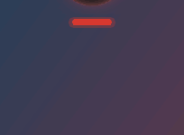 **Wake up** Slides in at start-up, opens its lids, double-blinks and pings. | 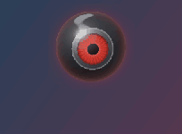 **Follow the pointer** Watches the mouse anywhere on the screen. | 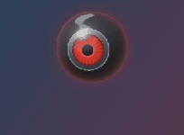 **Watch the text cursor** Follows the caret while you type (apps that expose it). |
| 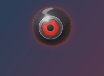 **Read along** Scans left to right while you type in apps that hide the caret. | 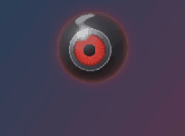 **Glance at windows** Looks at a window you switch to, with a ping. |   |

### Idle life: plays when the mouse rests

|   |   |   |
|:---:|:---:|:---:|
| 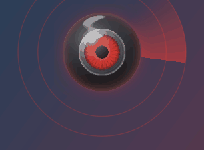 **Patrol** Checks parts of the screen in turn with sonar pings and a radar sweep. | 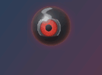 **Hunt** Squints at a spot, marks it with red sonar, then pounces. | 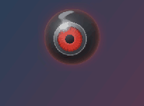 **Peer** Leans in, tilts its head, big pupil, slow curious blink. |
| 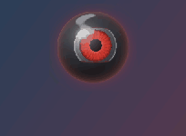 **Double take** Looks away, then snaps back to the pointer. | 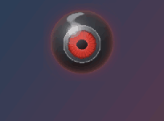 **Nod** Yes. | 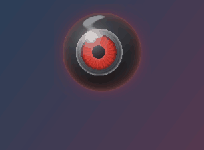 **Head shake** No. |
| 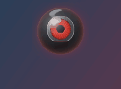 **Eye roll** Rolls its eye all the way round. | 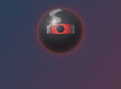 **Stretch** Stretches and squashes with its lids squeezed. | 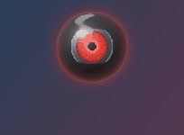 **Spin** Spins its iris and glows, thinking. |

### Getting tired: after a while alone, or late at night

|   |   |   |
|:---:|:---:|:---:|
| 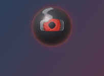 **Yawn** A big yawn as its energy runs low. | 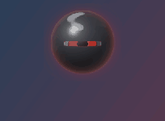 **Doze** Nods off, then jolts awake. | 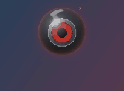 **Sleep** Heavy lids, slow breathing, floating z's. |

### Reactions

|   |   |   |
|:---:|:---:|:---:|
| 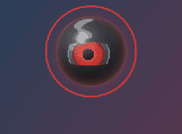 **Click** Bounces happily when you click it (and opens the panel). | 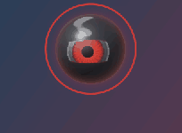 **Giggle** Rest the pointer on it. | 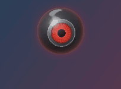 **Startle** Dart the pointer straight at it. |
| 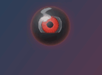 **Dizzy** Shake the mouse back and forth near it, or circle it. | 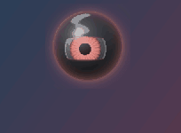 **Annoyed** Click it four times quickly. | 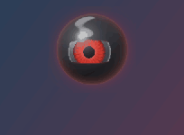 **Gulp** Copy something: it swallows it. |
| 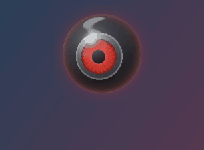 **Groove** Bobs and sways while music plays. |  **Strained** CPU maxed or PC hot: fast breathing, tremble, glow. |   |

### At work

|   |   |   |
|:---:|:---:|:---:|
| 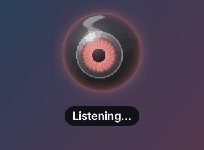 **Listening** Voice command: the iris brightens and pulses with your voice. | 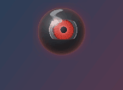 **Thinking** Working out what you said. | 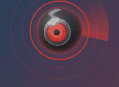 **Scanning** Stares at the area it reads for text capture, sweeping sonar. |
| 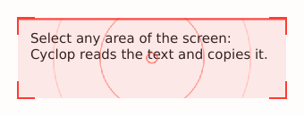 **Text capture** Red sonar sweep over the selected area (Ctrl+Shift+X). | 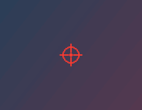 **Sonar mark** Left on the screen where it hunts or patrols. | 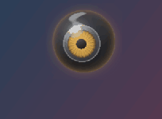 **Error** Shakes and turns amber when something fails. |

### Out of the way

|   |   |   |
|:---:|:---:|:---:|
| 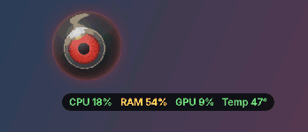 **Tuck away and peek** Slides above the screen edge leaving the stats, then peeks out now and then. |   |   |

## Repository layout

- [`windows/`](windows/): the app (`cyclop_windows/`), tests, build scripts and [release notes](windows/releases/).
- [`.github/workflows/`](.github/workflows/): Windows build and tests on every pull request, the release that publishes the `.exe` when a `windows/releases/<version>.md` note lands on `main`, and VirusTotal scans.

## Credits

Based on [Cyclop for macOS](https://github.com/akalikbergenov/cyclop) by **akalikbergenov** (MIT). The notch shape and panel layout follow the original design. This is an independent Windows project, not an official release by the original author; the original MIT license and copyright notice are kept in [LICENSE](LICENSE).

## Automated file scans

[VirusTotal workflow](https://github.com/MainTechAI/win_cyclop/actions/workflows/virustotal.yml) scans the EXE and ZIP after successful `main` builds and Windows releases. Commit reports are retained in Actions; release reports appear below and in the release notes. [Setup and rescan instructions](https://github.com/MainTechAI/win_cyclop/blob/main/windows/docs/virustotal.md).

<!-- virustotal:start -->
## VirusTotal scans

Scan target: `windows-v0.3.0`. Results refer to these exact file hashes.

| File / report | Status | Malicious | Suspicious | Undetected | Harmless | Other* | Analysis time |
| --- | --- | ---: | ---: | ---: | ---: | ---: | --- |
| [CyclopWindows.exe](https://www.virustotal.com/gui/file/8bb9a875367d315a9c9cbedaa36ca095804bf4eabdee78ee8f5e7ed948d6f633) | Completed | 2 | 0 | 65 | 0 | 8 | 2026-10-28 13:44 UTC |
| [CyclopWindows-win-x64.zip](https://www.virustotal.com/gui/file/39eef5809ec69e37e627ce7c159b1fe92865dc6018de8dde28c50ab53ec8c7f6) | Completed | 1 | 0 | 59 | 0 | 15 | 2026-10-28 13:47 UTC |

*Other includes timeouts, failures and unsupported file types. Undetected means no detection; it is not a safety guarantee.

SHA-256:

- `CyclopWindows.exe`: `8bb9a875367d315a9c9cbedaa36ca095804bf4eabdee78ee8f5e7ed948d6f633`
- `CyclopWindows-win-x64.zip`: `39eef5809ec69e37e627ce7c159b1fe92865dc6018de8dde28c50ab53ec8c7f6`

Reports may change as engines update. Known hashes reuse their existing report; the table shows that report’s analysis time.
<!-- virustotal:end -->
