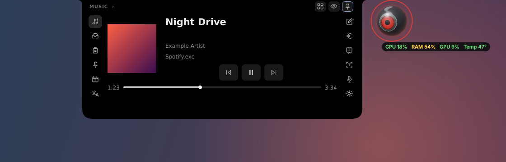

# Cyclop for Windows 11

A Windows adaptation of [akalikbergenov/cyclop](https://github.com/akalikbergenov/cyclop): an animated black notch that expands into a compact toolbox.

**The Windows application lives in [`windows/`](windows/).** The original macOS sources remain in this repository, with their original documentation in [README.macOS.md](README.macOS.md).

*Rendered Qt interface with simulated media metadata; this is a layout preview, not a Windows desktop capture.*

## Get started

1. Download **[CyclopWindows.exe](https://github.com/MainTechAI/win_cyclop/releases/latest)** from the latest release.
2. Run it. That's all: no Python or installation needed.

Windows may show **"Windows protected your PC"** because the build is unsigned. Choose **More info → Run anyway**. Cyclop then appears as a small notch at the top of the screen, with its eye beside it and an icon in the tray.

Prefer faster start-up? Download **CyclopWindows-win-x64.zip** from the same release, extract it, and run `CyclopWindows\CyclopWindows.exe` (keep the `_internal` folder next to it). To update, quit Cyclop from its tray menu and run the new download; your notes, snippets and settings are kept.

Developers can run from source instead: see [the Windows README](windows/README.md#run-from-source-developers).

## Included

- **Cyclop**: a living 3D eye beside the notch that looks around, follows your pointer, scans with red sonar and slides out of the way when idle, with optional CPU/RAM/GPU/temperature stats under it.
- **Image → text** (Ctrl+Shift+X): select any area of the screen; offline Windows OCR copies the text.
- **Define / translate the selection** (Ctrl+Alt+D / Ctrl+Alt+T) in a popup.
- **Voice commands and recording** with offline Whisper transcription (English and Russian).
- **Quick settings** with Keep awake and volume, plus app and output volume sliders.
- Hover expansion, concave notch shoulders, black panel and two icon rails; tabs cycle in a loop.
- Windows media session controls and artwork.
- File shelf with drag-and-drop and optional clipboard screenshots.
- Opt-in, session-only clipboard history and persistent snippets.
- Calendar import with recurring events and meeting links.
- Notes, teleprompter and daily currency conversion.
- Optional offline English/Russian translation using Argos models.
- Tray menu, **Ctrl+Alt+Space**, pin, privacy cover and monitor selection. Every feature can be switched off in Settings.

Calendar uses local `.ics` files rather than account sync. Offline translation of whole texts requires an optional source installation and language models; the release builds are unsigned and exclude the translation engine. Other platform differences and a Windows desktop smoke checklist are documented in [the Windows README](windows/README.md).

Original Cyclop by **akalikbergenov**, MIT licensed. This independent adaptation retains the upstream license and attribution.

## Automated file scans

[VirusTotal workflow](https://github.com/MainTechAI/win_cyclop/actions/workflows/virustotal.yml) scans the EXE and ZIP after successful `main` builds and Windows releases. Commit reports are retained in Actions; release reports appear below and in the release notes. [Setup and rescan instructions](https://github.com/MainTechAI/win_cyclop/blob/main/windows/docs/virustotal.md).

<!-- virustotal:start -->
## VirusTotal scans

Scan target: `windows-v0.2.1`. Results refer to these exact file hashes.

| File / report | Status | Malicious | Suspicious | Undetected | Harmless | Other* | Analysis time |
| --- | --- | ---: | ---: | ---: | ---: | ---: | --- |
| [CyclopWindows.exe](https://www.virustotal.com/gui/file/4d0a618c097256c03969d1333a2f544935068c6b1d61fb08279b38f6e1ffb28e) | Completed | 2 | 0 | 66 | 0 | 7 | 2026-10-27 21:58 UTC |
| [CyclopWindows-win-x64.zip](https://www.virustotal.com/gui/file/ec8d5e908b8f8501140abbdb8b4d9532f9ab6bb6cd725727ebd10b8f3568b706) | Completed | 0 | 0 | 54 | 0 | 21 | 2026-10-27 22:01 UTC |

*Other includes timeouts, failures and unsupported file types. Undetected means no detection; it is not a safety guarantee.

SHA-256:

- `CyclopWindows.exe`: `4d0a618c097256c03969d1333a2f544935068c6b1d61fb08279b38f6e1ffb28e`
- `CyclopWindows-win-x64.zip`: `ec8d5e908b8f8501140abbdb8b4d9532f9ab6bb6cd725727ebd10b8f3568b706`

Reports may change as engines update. Known hashes reuse their existing report; the table shows that report’s analysis time.
<!-- virustotal:end -->
